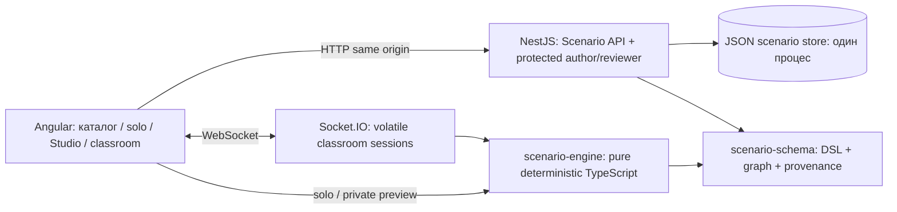

# Ethical Dilemmas Simulator

Освітній симулятор етичних дилем українською мовою. Є Angular/NestJS, Scenario DSL
та два demo-only CIDS-inspired JSON. Stage 05 додає повний Angular solo-прохід:
каталог → narrative/рішення → наслідки → ending → debrief, через готовий `@eds/scenario-engine`.
Деталі фактичного стану й smoke: [README клієнта](apps/client/README.md).

Stage 06 додає NestJS Scenario API та захищений form-based Studio (`/studio`):
приватні чернетки, validation/import/export, ізольований participant preview,
явний demo-only показ і незмінні публічні версії. Каталог тепер використовує API;
для роботи запускайте також `pnpm dev:api`. Серверні capabilities вводяться
автором під час роботи й не вбудовуються у frontend. Фактичний reviewer gate
вимкнений до появи реального рецензента. PostgreSQL не налаштований: є файлове
сховище для одного процесу, без даних учасників. Налаштування, API та обмеження:
[server README](apps/server/README.md).

Stage 07 додає аудиторне заняття: `/classroom/host` для ведучого та
`/classroom/join` або `/classroom/join/:pin` для учасників. Socket.IO синхронізує
одну спільну engine-гілку; індивідуальних звітів і live-підрахунку немає.
Після закриття точний агрегат доступний лише за ≥3 поданих голосів.
Кімнати, токени та поточні голоси живуть лише в пам’яті й очищаються за TTL.
Протокол, запуск, reconnect і межі анонімності:
[Classroom README](apps/server/src/classroom/README.md).

## Структура

```text
apps/client/       Angular 21, standalone компоненти, Jasmine/Karma
apps/server/       NestJS 11 + Express, CommonJS, Jest/Supertest
packages/scenario-schema/ незалежний DSL v1, Zod, graph/provenance validation
packages/scenario-engine/ детермінований runtime без framework/network залежностей
content/scenarios/ два сценарії й явний JSON-індекс для static adapter
```

Порожні каталоги не відтворюються Git до додавання файлів.
Назви workspace-пакетів: `client` та `server`.

## Середовище та встановлення

- Node.js **22.22.3 або новіша версія гілки 22** (`>=22.22.3 <23`).
- pnpm **10.0.0**, зафіксований у `packageManager`.
- Chrome для Angular unit-тестів; для нестандартного шляху задайте `CHROME_BIN`.

Версію Node записано в `.nvmrc`; використовуйте свій менеджер Node.
Після встановлення pnpm потрібної версії виконайте з кореня:

```sh
pnpm install --frozen-lockfile
pnpm build
```

Використовуйте єдиний `pnpm-lock.yaml`; не створюйте npm lock-файли в застосунках.
Перевірки engines та peer dependencies увімкнені в `.npmrc`.
Node 22.12.0 підходить Angular 21, але транзитивні ESLint-залежності потребують
новішого Node 22; перевірений runtime цього workspace — 22.22.3.
У Windows PowerShell із заблокованими `.ps1` запускайте `pnpm.cmd` замість `pnpm`.

## Локальний запуск

У двох терміналах із кореня:

```sh
pnpm dev:web
pnpm dev:api
```

Клієнт: `http://localhost:4200`; сервер: `http://localhost:3000`.
Сервер повертає `Hello World!` на `GET /api` та health-статус на `GET /api/health`:

```json
{"status":"ok","service":"ethical-dilemmas-api"}
```

Перевірка напряму й через Angular dev proxy:

```sh
curl http://localhost:3000/api/health
curl http://localhost:4200/api/health
```

Стартовий екран — `/scenarios`. Каталог і preview використовують API; NestJS має
працювати. За його недоступності UI показує error/retry без прихованої підміни
статичним контентом. `/api/health` не виконує фонового polling і не розкриває секретів.

API вже читає `PORT` із середовища (типово 3000); `.env` автоматично не завантажується.
Наприклад, у PowerShell: `$env:PORT='3001'; pnpm.cmd dev:api`.
Якщо порт змінено, відповідно змініть target у `apps/client/proxy.conf.json`
і перезапустіть Angular dev server. Solo/classroom не потребують секретів у конфігурації.
Studio за замовчуванням вимкнений (503). Для локального авторингу перед запуском API
задайте випадковий server-only `AUTHOR_KEY` довжиною ≥32 символи й введіть його
в password-поле `/studio`. Не записуйте ключ у Git, Angular config або shell transcript.
`REVIEWER_KEY` залишайте порожнім до фактичного людського review.
Змінні описано в [server/.env.example](apps/server/.env.example); файл не завантажується автоматично.

HealthService використовує відносний `/api/health`. Proxy зареєстрований лише для
dev server та не входить до production bundle. У production вебсервер має
передавати `/api/*` до NestJS на тому самому origin; dev proxy там не потрібен.
Широкий CORS не вмикається.

## Перевірки

```sh
pnpm build        # production build обох застосунків
pnpm typecheck    # Angular templates, client specs, server TypeScript
pnpm test         # schema tests, Angular unit, Nest unit, потім Nest e2e
pnpm test:e2e     # лише Nest e2e
pnpm lint         # schema, engine і server ESLint, без --fix
node content/qa/validate.mjs
node --test content/qa/content.test.mjs
node apps/client/scripts/check-solo-routes.mjs
node scripts/check-release-safety.mjs
```

Lint перевіряє scenario-schema, scenario-engine та server без автоматичного виправлення.
Angular ESLint поки не налаштовано. Для інтерактивних тестів:

```sh
pnpm --filter client test:watch
pnpm --filter server test:watch
```

Збірки розміщуються в `apps/client/dist/client/` та `apps/server/dist/`.
Для запуску зібраного API: `pnpm --filter server start:prod`.

## Міграція середовища

Angular оновлено послідовно 17 → 18 → 19 → 20 → 21 з офіційними CLI/Core
migrations та production-збіркою після кожного major. Для встановлення пакетів
перевірено strict peer dependencies; NestJS залишено CommonJS.
Сумісність: [Angular version matrix](https://angular.dev/reference/versions),
[Angular migrations](https://angular.dev/cli/update).

У залежностях залишаються deprecated пакети; їх масове оновлення не виконувалося.

## Scenario Schema (Stage 02)

Пакет `@eds/scenario-schema` містить Zod-схеми, inferred types, структурну й
семантичну перевірку, машинозчитувані діагностики та JSON Schema export.
Контракт: [README пакета](packages/scenario-schema/README.md);
рішення: [ADR 0001](docs/adr/0001-scenario-dsl-v1.md).
Повний мінімальний JSON: [synthetic fixture](packages/scenario-schema/test/fixtures/minimal.json).
Це тестові demo-only дані, а не перевірені навчальні чи правові матеріали.

```sh
pnpm --filter @eds/scenario-schema test
```

`pnpm build` збирає shared package до застосунків та запускає окремий Angular
esbuild import smoke. `pnpm typecheck` спершу будує shared declarations.
`pnpm test` включає тести пакета та імпорту в обох застосунках; `pnpm lint`
перевіряє schema, engine і сервер. Подальші етапи додають solo, Studio та classroom.

## Архітектура та відтворювані URL



| Local URL | Призначення |
|---|---|
| `http://localhost:4200/scenarios` | Каталог двох кейсів |
| `/scenarios/urgent-supply/play` | Повний solo із трьома рішеннями |
| `/scenarios/truth-under-pressure/play` | Другий кейс |
| `/studio` | Захищений авторинг; ключ вводиться під час роботи |
| `/classroom/host` | Створення кімнати, контроль раундів |
| `/classroom/join` | PIN-only приєднання; URL з PIN генерує ведучий |

На першому запуску API копіює лише файли з `content/scenarios/index.json` у
`apps/server/.data/scenarios.json` як явно demo-only. Оригінальні JSON лишаються
draft; це не review. Існуюче сховище не пересіюється й не перезаписується.
За потреби задайте **новий** абсолютний `SCENARIO_DATA_FILE`, зберігши старий файл.
PostgreSQL/ORM/Compose/міграцій немає; `DATABASE_URL` зупиняє старт, доки не реалізовано
відповідний adapter. Не запускайте непідтримувану БД для демо. Потрібен один API-процес.

## Детерміновані правила та навчальний зміст

JSON задає розгалужений граф; shared validator перевіряє всі повні маршрути,
мінімум три рішення й два choices, посилання, цикли та досяжність delayed triggers.
Engine не має LLM, прихованої випадковості, `eval` або довільного коду з контенту.

При підтвердженні вибору engine застосовує immediate deltas, збільшує лічильник
рішень, планує events, застосовує належні `after_decisions`, а потім входить у
цільовий вузол і застосовує `on_enter_node`. `count` не включає рішення, яке
створило event. Кожна подія спрацьовує один раз. Narrative-перехід не є рішенням.
Нереалізовані події на ending показуються окремо й не змінюють фінальні метрики.

Чотири показники починаються з нуля; цілі deltas від −10 до 10 на effect додаються
без загального морального балу чи оцінки людини. Це авторська модель наслідків,
не психометричний інструмент і не юридичний висновок. Host вибирає спільну гілку
для обговорення; більшість голосів не є автоматичним етичним схваленням.

| Сценарій | Авторська основа | Повні маршрути / рішення / endings |
|---|---|---|
| Постачання під тиском | CIDS №16: закупівля обладнання; адаптація до резервного живлення навчання | 8 / 3 на кожному / 4 |
| Професійна правда під тиском | CIDS №1: професійна порада та очікування керівництва | 8 / 3 на кожному / 4 |

У кожному JSON — `draft`, `demoOnly=true`, `aiAssisted=true`; по три unverified
джерела. Першоджерела та українська правова застосовність не підтверджені;
CIDS є методичним орієнтиром, не підтвердженням чинного українського права.
Карти й нотатки: [content README](content/README.md). Потрібне окреме людське review.

## Release-перевірки та передача команді

Після build із установленим Chrome/Edge:

```powershell
$env:CHROME_BIN='C:/Program Files (x86)/Microsoft/Edge/Application/msedge.exe'
node apps/client/scripts/smoke-solo.mjs
node apps/client/scripts/smoke-studio.mjs
node apps/client/scripts/smoke-classroom.mjs
```

На Linux задайте `CHROME_BIN` шляхом до встановленого `google-chrome`.
Smoke піднімають власний API з тимчасовими synthetic даними й випадковими runtime
ключами; робоче Studio-сховище не використовується. Classroom має чотири окремі
browser contexts. Порт для тестового API/host вибирається автоматично.
Конфігурація [CI](.github/workflows/release-checks.yml) повторює ці команди для
Linux/Windows, без deploy або application secrets; її hosted запуск ще має
відбутися після окремо погодженого push. Версії залежностей не оновлювались.

- [Acceptance gates і докази](docs/MVP_ACCEPTANCE.md)
- [Release findings та punch list](docs/RELEASE_READINESS.md)
- [Privacy review та інфраструктурні обмеження](docs/SECURITY_PRIVACY.md)
- [Як використано ШІ — коротка записка](docs/AI_USAGE_UA.md)
- [Live/video demo outlines](docs/DEMO_OUTLINE_UA.md)
- [Можлива інтеграція Moodle / Дія.Освіта](docs/LMS_INTEGRATION.md)

Технічне локальне демо готове; експертний випуск і фінальна подача лишаються
**PARTIAL** до рішень команди. Відео, фінальний PDF, правове review, права на
матеріали та актуальні правила події не підтверджені цими автоматизованими тестами.
